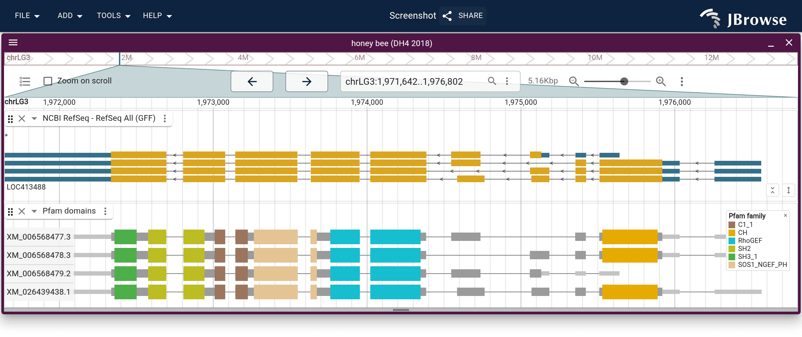

# domains2genome

domains2genome places protein domain calls on the genome, so a genome browser
can draw them over the exons that encode them.

- **In:** gene models (GFF3 or GTF) and domain calls on their proteins
  (InterProScan TSV or GFF3, or HMMER `--domtblout` from hmmscan or hmmsearch)
- **Out:** BED12, one row per domain with a block per exon it spans; or with
  `--gff3`, each coding transcript with its domains as children



Pfam domains on the four isoforms of the honey bee _vav_ gene, from
`domains2genome --gff3` in JBrowse 2's multi-row display. [Open this view in
JBrowse][demo], or follow JBrowse's [protein domains tutorial][tutorial], which
builds it from the genome up.

## Usage

```bash
npx domains2genome genes.gff3 interpro.tsv > domains.bed
```

or install it with `npm install -g domains2genome`.

| Option           | Effect                                                                              |
| ---------------- | ----------------------------------------------------------------------------------- |
| `--source <a,b>` | keep only these analyses, as InterProScan's fourth column names them (`Pfam,SMART`) |
| `--gff3`         | write GFF3 instead of BED12 (see [BED12 or GFF3?](#bed12-or-gff3))                  |
| `--out <file>`   | write to a file instead of stdout                                                   |

Either input may be gzipped (`.gz` or `.bgz`). The proteins must be translated
from the same gene models, and named by the transcript ID, the CDS `protein_id`
or the CDS ID, as `gffread -y`, NCBI and Ensembl protein FASTA are. A name that
matches no transcript is reported on stderr.

## BED12 or GFF3?

Both formats hold the same domains, placed the same way. They differ in what
else the file holds, and so in how a browser draws it.

|                            | BED12 (default)                                       | GFF3 (`--gff3`)                                                                      |
| -------------------------- | ----------------------------------------------------- | ------------------------------------------------------------------------------------ |
| Holds                      | the domains only, one row each                        | every coding transcript, with its domains as children; non-coding genes are left out |
| Looks like                 | a domain track of its own, beside the gene track      | each transcript with its domains over its exons                                      |
| Links domain to transcript | by label only, in the `transcript` column             | by `Parent`, so isoforms keep their own domains                                      |
| Drawn as intended by       | IGV, the UCSC browser, JBrowse; bedtools reads it too | JBrowse; other browsers may not draw `protein_match` children on the transcript      |
| Index with                 | `tabix -p bed`                                        | `tabix -p gff`                                                                       |

Choose BED12 to add domains to a browser that already shows the genes, or to use
them in other tools. Choose GFF3 to see which isoform carries which domain: in
JBrowse's multi-row display each transcript gets a row of its own.

### BED12

Rows are sorted by contig and start, under a `#` line naming the columns, so
`bgzip` and `tabix -p bed` index the file as written. A domain crossing an
intron is one row with a block on each exon (tabs shown as spaces):

```
ctgA  121  212  Protein kinase domain  50  +  121  212  0  2  9,12  0,79  PF00069  Protein kinase domain  Pfam  XM_1.1  8  14  1E-5
```

The `score` is ten times −log10(E-value), capped at 1000, so 1e-50 scores 500.
Seven columns follow the twelve BED ones:

| Column                       | Holds                                                                      |
| ---------------------------- | -------------------------------------------------------------------------- |
| `accession`                  | the signature's accession, e.g. `PF00069`                                  |
| `description`                | the InterPro entry's description, else the signature's; `-` from hmmsearch |
| `source`                     | the analysis: `Pfam`, `SMART`, … or `HMMER`                                |
| `transcript`                 | the transcript's label in JBrowse: its GFF3 `Name`, else its ID            |
| `proteinStart`, `proteinEnd` | the residues the domain covers, 1-based                                    |
| `evalue`                     | the E-value as the caller wrote it                                         |

Where two coding transcripts share a `Name`, each is labeled by its ID instead.
A GTF transcript is labeled by its `transcript_id`.

### GFF3

```bash
domains2genome genes.gff3 pfam.domtblout --gff3 | bgzip > domains.gff3.gz
tabix -p gff domains.gff3.gz
```

- Each coding transcript is an `mRNA` with its `exon` and `CDS` lines, written
  with or without a domain on it
- The `mRNA` keeps the annotation's `ID` and `Name`, plus the CDS's `protein_id`
  and `product`
- A `protein_match` carries the analysis as its source and the E-value as its
  score, with `Name`, `accession`, `description`, `proteinStart` and
  `proteinEnd` attributes. A domain crossing an intron takes a line per exon,
  sharing one `ID`

## From a genome to its domains

Translate the gene models, call domains on the proteins with InterProScan or
HMMER, then place the calls.

### 1. Translate the gene models

```bash
# one protein per coding transcript, named by its transcript ID; gffread
# reads an uncompressed FASTA
gffread -y proteins.faa -g genome.fa genes.gff3

# write each stop codon as X: InterProScan refuses `*` and `.`, and X keeps
# every residue at its position
sed -i '/^>/!s/[.*]/X/g' proteins.faa
```

### 2a. Call domains with InterProScan

```bash
nextflow run ebi-pf-team/interproscan6 -r 6.0.3.0 -profile docker \
  --datadir data --input proteins.faa \
  --applications Pfam --formats gff3
```

- This writes `proteins.faa.gff3`. Prefer it to `--formats tsv`: the GFF3 names
  each domain by its short name (`Gp_dh_N`), the TSV by its description, and the
  name labels a browser track better
- Leave out `--applications` to run every analysis, then choose with `--source`
- Without Docker, use `-profile apptainer`; on a cluster,
  `-profile singularity,slurm` runs each batch as a job
- InterProScan 5 takes
  `interproscan.sh -i proteins.faa -f tsv -appl Pfam -o proteins.faa.tsv`

### 2b. Or call Pfam domains with HMMER

```bash
# once: Pfam's models, pressed for hmmscan (about 1.5 GB)
curl -fLO https://ftp.ebi.ac.uk/pub/databases/Pfam/current_release/Pfam-A.hmm.gz
gunzip Pfam-A.hmm.gz
hmmpress Pfam-A.hmm

hmmscan --cut_ga --cpu 4 --noali --domtblout pfam.domtblout \
  Pfam-A.hmm proteins.faa > /dev/null
```

`--cut_ga` applies Pfam's curated threshold for each family, as InterPro does.
HMMER reports every family that clears it, so related families stack on one
stretch of protein; where two hits overlap by more than half, domains2genome
keeps the lower E-value. (`pfam_scan` and InterProScan only resolve hits within
one Pfam clan.)

hmmscan keeps about two cores busy whatever `--cpu` asks, so for a whole
proteome, split the proteins and scan the parts at once:

```bash
awk -v n=8 '/^>/ { i = (i + 1) % n } { print > ("chunk." i ".faa") }' proteins.faa
for f in chunk.*.faa; do
  hmmscan --cut_ga --cpu 2 --noali --domtblout "$f.domtblout" \
    Pfam-A.hmm "$f" > /dev/null &
done
wait
cat chunk.*.faa.domtblout > pfam.domtblout
```

### 3. Place the calls on the genome

```bash
domains2genome genes.gff3 proteins.faa.gff3 > domains.bed  # InterProScan
domains2genome genes.gff3 pfam.domtblout > domains.bed     # HMMER

bgzip domains.bed
tabix -p bed domains.bed.gz
```

IGV, the UCSC browser and JBrowse all draw the result.

## As a library

The package exports what the command line runs, with TypeScript types; see
[docs/library.md](https://github.com/GMOD/domains2genome/blob/main/docs/library.md).

## From interproscan2genome

domains2genome was called `interproscan2genome` before 2.0. That command and its
`--genomeGFF` and `--interproGFF` flags still run, but now print BED12 with a
block per exon, where 1.x printed one GFF3 span across the introns. 1.x also
divided residue positions by three, which put each domain about a third of the
way along its protein.

[demo]:
  https://jbrowse.org/code/jb2/main/?config=https%3A%2F%2Fjbrowse.org%2Fhubs%2Fgenark%2FGCF%2F003%2F254%2F395%2FGCF_003254395.2%2Fconfig.json&session=spec-%7B%22sessionTracks%22%3A%5B%7B%22type%22%3A%22FeatureTrack%22%2C%22trackId%22%3A%22pfam_domains%22%2C%22name%22%3A%22Pfam%20domains%22%2C%22assemblyNames%22%3A%5B%22GCF_003254395.2%22%5D%2C%22adapter%22%3A%7B%22type%22%3A%22Gff3TabixAdapter%22%2C%22uri%22%3A%22https%3A%2F%2Fjbrowse.org%2Fdemos%2Fprotein_domains%2Fpfam.gff3.gz%22%2C%22csi%22%3Atrue%7D%2C%22displays%22%3A%5B%7B%22type%22%3A%22LinearMultiRowFeatureDisplay%22%2C%22displayId%22%3A%22pfam_domains-LinearMultiRowFeatureDisplay%22%2C%22encoding%22%3A%7B%22color%22%3A%7B%22field%22%3A%22name%22%2C%22legend%22%3A%7B%22title%22%3A%22Pfam%20family%22%7D%7D%7D%7D%5D%7D%5D%2C%22views%22%3A%5B%7B%22type%22%3A%22LinearGenomeView%22%2C%22assembly%22%3A%22GCF_003254395.2%22%2C%22loc%22%3A%22NC_037640.1%3A1%2C971%2C640-1%2C976%2C800%22%2C%22tracks%22%3A%5B%7B%22trackId%22%3A%22GCF_003254395.2-ncbiGff%22%7D%2C%7B%22trackId%22%3A%22pfam_domains%22%2C%22height%22%3A120%7D%5D%7D%5D%7D&sessionName=Screenshot
[tutorial]: https://jbrowse.org/jb2/docs/tutorials/protein_domains/
