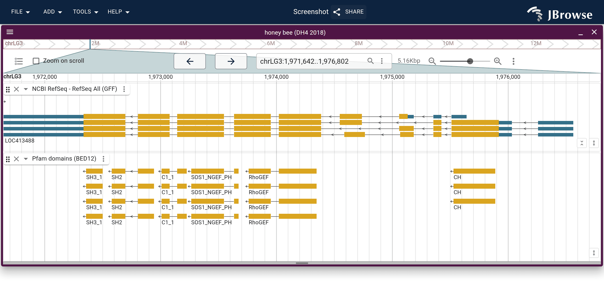

# domains2genome

Places protein domain calls on the genome, so a genome browser can draw them
over the exons that encode them.

```bash
npx domains2genome genes.gff3 pfam.domtblout > domains.bed
```

It reads gene models (GFF3 or GTF) and the domains called on their proteins
(InterProScan TSV or GFF3, or HMMER `--domtblout`), either plain or gzipped.

## Output

**BED12**, the default: one row per domain, with a block on each exon it spans.
IGV, the UCSC browser and JBrowse draw it as a domain track beside the gene
track. ([Open in JBrowse][bed-demo])



**GFF3**, with `--gff3`: each coding transcript with its domains as children, so
each isoform shows its own domains. Shown here in JBrowse 2's multi-row display.
([Open in JBrowse][gff3-demo])


[Output formats](docs/output.md) lists the columns and attributes, and when to
choose each.

See also JBrowse 2's [protein domains tutorial][tutorial]

## Options

| Option           | Effect                                                                              |
| ---------------- | ----------------------------------------------------------------------------------- |
| `--gff3`         | write GFF3 instead of BED12                                                         |
| `--source <a,b>` | keep only these analyses, as InterProScan's fourth column names them (`Pfam,SMART`) |
| `--out <file>`   | write to a file instead of stdout                                                   |

The proteins must be named by the transcript ID, the CDS `protein_id` or the CDS
ID, as `gffread -y`, NCBI and Ensembl protein FASTA are.

## More

- [From a genome to its domains](docs/pipeline.md): overview of the 'pipeline'
- [Output formats](docs/output.md): using BED12 or GFF3, which to choose
- [As a library](docs/library.md): the functions the command line runs
- [JBrowse 2's protein domains tutorial][tutorial]: example using the honey bee
  genome

[bed-demo]:
  https://jbrowse.org/code/jb2/main/?config=https%3A%2F%2Fjbrowse.org%2Fhubs%2Fgenark%2FGCF%2F003%2F254%2F395%2FGCF_003254395.2%2Fconfig.json&session=spec-%7B%22sessionTracks%22%3A%5B%7B%22type%22%3A%22FeatureTrack%22%2C%22trackId%22%3A%22pfam_domains_bed%22%2C%22name%22%3A%22Pfam+domains+%28BED12%29%22%2C%22assemblyNames%22%3A%5B%22GCF_003254395.2%22%5D%2C%22adapter%22%3A%7B%22type%22%3A%22BedTabixAdapter%22%2C%22bedGzLocation%22%3A%7B%22uri%22%3A%22https%3A%2F%2Fjbrowse.org%2Fdemos%2Fprotein_domains%2Fpfam.bed.gz%22%7D%2C%22index%22%3A%7B%22location%22%3A%7B%22uri%22%3A%22https%3A%2F%2Fjbrowse.org%2Fdemos%2Fprotein_domains%2Fpfam.bed.gz.tbi%22%7D%7D%7D%7D%5D%2C%22views%22%3A%5B%7B%22type%22%3A%22LinearGenomeView%22%2C%22assembly%22%3A%22GCF_003254395.2%22%2C%22loc%22%3A%22NC_037640.1%3A1%2C971%2C640-1%2C976%2C800%22%2C%22tracks%22%3A%5B%7B%22trackId%22%3A%22GCF_003254395.2-ncbiGff%22%7D%2C%7B%22trackId%22%3A%22pfam_domains_bed%22%2C%22height%22%3A180%7D%5D%7D%5D%7D&sessionName=Screenshot
[gff3-demo]:
  https://jbrowse.org/code/jb2/main/?config=https%3A%2F%2Fjbrowse.org%2Fhubs%2Fgenark%2FGCF%2F003%2F254%2F395%2FGCF_003254395.2%2Fconfig.json&session=spec-%7B%22sessionTracks%22%3A%5B%7B%22type%22%3A%22FeatureTrack%22%2C%22trackId%22%3A%22pfam_domains%22%2C%22name%22%3A%22Pfam%20domains%22%2C%22assemblyNames%22%3A%5B%22GCF_003254395.2%22%5D%2C%22adapter%22%3A%7B%22type%22%3A%22Gff3TabixAdapter%22%2C%22uri%22%3A%22https%3A%2F%2Fjbrowse.org%2Fdemos%2Fprotein_domains%2Fpfam.gff3.gz%22%2C%22csi%22%3Atrue%7D%2C%22displays%22%3A%5B%7B%22type%22%3A%22LinearMultiRowFeatureDisplay%22%2C%22displayId%22%3A%22pfam_domains-LinearMultiRowFeatureDisplay%22%2C%22encoding%22%3A%7B%22color%22%3A%7B%22field%22%3A%22name%22%2C%22legend%22%3A%7B%22title%22%3A%22Pfam%20family%22%7D%7D%7D%7D%5D%7D%5D%2C%22views%22%3A%5B%7B%22type%22%3A%22LinearGenomeView%22%2C%22assembly%22%3A%22GCF_003254395.2%22%2C%22loc%22%3A%22NC_037640.1%3A1%2C971%2C640-1%2C976%2C800%22%2C%22tracks%22%3A%5B%7B%22trackId%22%3A%22GCF_003254395.2-ncbiGff%22%7D%2C%7B%22trackId%22%3A%22pfam_domains%22%2C%22height%22%3A120%7D%5D%7D%5D%7D&sessionName=Screenshot
[tutorial]: https://jbrowse.org/jb2/docs/tutorials/protein_domains/
