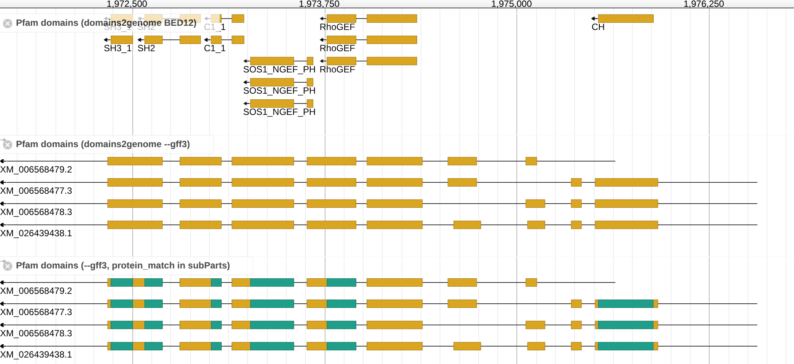

# Output formats

Both formats hold the same domains, placed the same way. They differ in what
else the file holds, and so in how a browser draws it.

|                            | BED12 (default)                                               | GFF3 (`--gff3`)                                                                      |
| -------------------------- | ------------------------------------------------------------- | ------------------------------------------------------------------------------------ |
| Holds                      | the domains only, one row each                                | every coding transcript, with its domains as children; non-coding genes are left out |
| Looks like                 | a domain track of its own, beside the gene track              | each transcript with its domains over its exons                                      |
| Links domain to transcript | by label only, in the `transcript` column                     | by `Parent`, so isoforms keep their own domains                                      |
| Drawn as intended by       | IGV, the UCSC browser, JBrowse 1 and 2; bedtools reads it too | JBrowse 2's multi-row display; JBrowse 1 with [one setting](#in-jbrowse-1)           |
| Index with                 | `tabix -p bed`                                                | `tabix -p gff`                                                                       |

Choose BED12 to add domains to a browser that already shows the genes, or to use
them in other tools. Choose GFF3 to see which isoform carries which domain.

## BED12

Rows are sorted by contig and start, under a `#` line naming the columns, so
`bgzip` and `tabix -p bed` index the file as written. A domain crossing an
intron is one row with a block on each exon (tabs shown as spaces):

```
ctgA  121  212  Protein kinase domain  50  +  121  212  0  2  9,12  0,79  PF00069  Protein kinase domain  Pfam  XM_1.1  8  14  1E-5
```

The `score` is ten times −log10(E-value), capped at 1000, so 1e-50 scores 500.
Seven columns follow the twelve BED ones:

| Column                       | Holds                                                                      |
| ---------------------------- | -------------------------------------------------------------------------- |
| `accession`                  | the signature's accession, e.g. `PF00069`                                  |
| `description`                | the InterPro entry's description, else the signature's; `-` from hmmsearch |
| `source`                     | the analysis: `Pfam`, `SMART`, … or `HMMER`                                |
| `transcript`                 | the transcript's label in JBrowse: its GFF3 `Name`, else its ID            |
| `proteinStart`, `proteinEnd` | the residues the domain covers, 1-based                                    |
| `evalue`                     | the E-value as the caller wrote it                                         |

Where two coding transcripts share a `Name`, each is labeled by its ID instead.
A GTF transcript is labeled by its `transcript_id`.

## GFF3

```bash
domains2genome genes.gff3 pfam.domtblout --gff3 | bgzip > domains.gff3.gz
tabix -p gff domains.gff3.gz
```

- Each coding transcript is an `mRNA` with its `exon` and `CDS` lines, written
  with or without a domain on it
- The `mRNA` keeps the annotation's `ID` and `Name`, plus the CDS's `protein_id`
  and `product`, and names its gene in `gene`: the parent gene's `Name`, else
  the mRNA's own `gene` tag, else the gene's ID (from a GTF, `gene_name`, else
  `gene_id`)
- A `protein_match` carries the analysis as its source and the E-value as its
  score, with `Name`, `accession`, `description`, `proteinStart` and
  `proteinEnd` attributes. A domain crossing an intron takes a line per exon,
  sharing one `ID`

A transcript glyph in JBrowse 2's default feature display, as in JBrowse 1's,
draws only an mRNA's CDS and UTR children, so it shows the transcripts without
their domains. JBrowse 2's multi-row display draws the `protein_match` children
over the exons, colored by family, as the [README](../README.md#output) figure
shows.

## In JBrowse 1

Both formats load as tabix tracks in JBrowse 1.17. BED12 needs nothing more than
the `BEDTabix` store. For GFF3, JBrowse 1 draws only the CDS and UTR children of
an mRNA, so the domains stay hidden until `subParts` names `protein_match`:

```json
{
  "label": "pfam_domains",
  "type": "CanvasFeatures",
  "storeClass": "JBrowse/Store/SeqFeature/GFF3Tabix",
  "urlTemplate": "domains.gff3.gz",
  "subParts": "CDS, UTR, five_prime_UTR, three_prime_UTR, protein_match",
  "style": {
    "color": "function(feature) { return feature.get('type') === 'protein_match' ? '#1f9e89' : 'goldenrod' }"
  }
}
```

Each transcript then shows its domains over its CDS, in one color and without
the family names JBrowse 2 draws.



From the top: the BED12, the GFF3 as JBrowse 1 draws it by default, and the GFF3
with the setting above.
